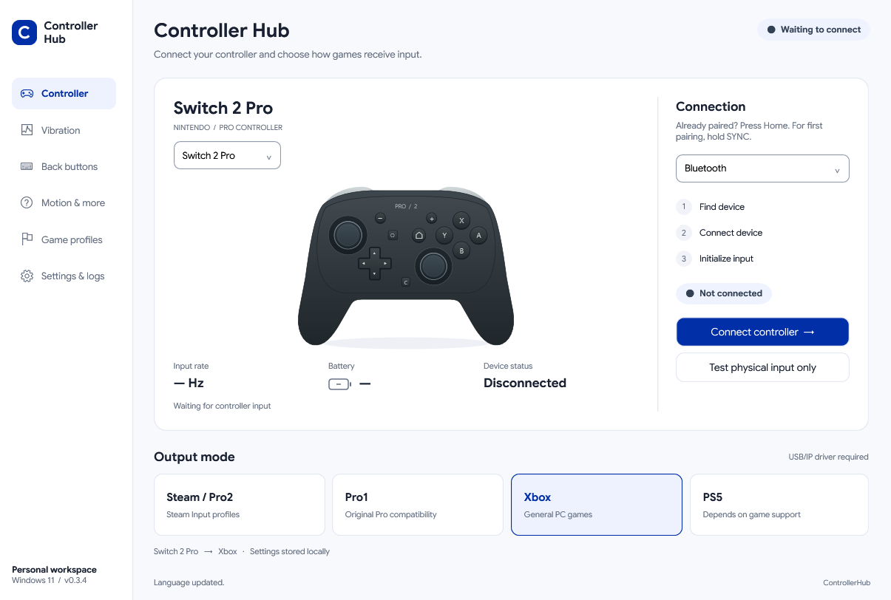

# ControllerHub

**English** · [简体中文](README.zh-Hans.md) · [繁體中文](README.zh-Hant.md)

Connect a Nintendo Switch 2 Pro Controller or Sony DualSense to a Windows PC over USB or Bluetooth. Choose the virtual controller your game expects, map extra buttons, and adjust motion and rumble from one window.

Windows 11 x64 · .NET 10 · GPL-3.0-or-later · **v1.0.0**



## Quick start

1. Open [GitHub Releases](https://github.com/MostimaJK/ControllerHub/releases) and choose a Windows x64 download. The portable EXE includes .NET and prepares a local cache on first launch. The smaller ZIP requires the **.NET 10 Desktop Runtime x64**. Extract the entire ZIP before running it.
2. For virtual gamepad output, install the **usbip-win2 Client** driver. Both downloads require it. To check physical input alone, use the input-only test on the controller page.
3. Open ControllerHub, choose your controller and connection method, then select an output mode. **Xbox** is a good starting point for most Windows games.
4. Select **Connect controller**. Once the app shows **Connected · Game output ready**, open your game.

The app starts in English on first launch. Open **Settings & logs → Language** to choose English, 简体中文 or 繁體中文. Your choice is saved on this PC.

## Controller support

| Feature | What you can do |
| --- | --- |
| Virtual output | Choose Xbox, PS5, Pro1 or Steam / Pro2. Games can run outside Steam. Motion and advanced feedback depend on game or middleware support. |
| Switch 2 Pro | Map GL, GR and C in a local profile. Adjust rumble strength and test supported HD rumble paths. |
| DualSense | Use USB input and forward supported haptics and adaptive-trigger effects over USB. Bluetooth input still needs hardware validation. |
| Motion | Read six-axis input, save a stationary calibration and forward motion to a compatible output mode. |
| Diagnostics | Follow the connection steps, check battery and input report rate, and preview a diagnostic report. Report rate measures incoming samples, not end-to-end latency. |

See the [1.0.0 release notes](RELEASE_NOTES.md) for downloads and validation limits. Detailed guides in Traditional Chinese cover [installation](docs/install.md), [usage](docs/usage.md), [compatibility](docs/features.md), [troubleshooting](docs/troubleshooting.md) and [known issues](docs/known-issues.md).

## Build from source

On Windows x64 with Git and the .NET 10 SDK, run these commands from the project root:

```powershell
./scripts/bootstrap.ps1
./build.ps1 -Check -Package
```

Bootstrap restores the pinned upstream source, applies the integration patch and checks backend hashes. The build writes the application to `dist/` and the ZIP and SHA-256 checksum to `releases/latest/`. Run `./scripts/build-portable.ps1` to build the self-contained EXE.

The packaged app opens the WebView2 interface and falls back to WPF if WebView2 cannot start. To compare interfaces from a source checkout, close the running instance and use one of these launchers. They share the same engine and local settings.

| Interface | Source launcher |
| --- | --- |
| WebView2 | `Start-ControllerHub-WebView2.bat` |
| Native WPF | `Start-ControllerHub.bat` |
| Electron | `Start-ControllerHub-Electron.bat` (uses npm if Electron is missing) |

## License and credits

ControllerHub is an independent community project licensed under [GPL-3.0-or-later](COPYING). It builds on [DS4Windows](https://github.com/hbashton/DS4Windows), [PRO2 Bridge](https://github.com/LeonChrome/XinHeLianSheng-Pro2-Bridge), [usbip-win2](https://github.com/vadimgrn/usbip-win2) and optional [HidHide](https://github.com/nefarius/HidHide) support. Controller artwork comes from [NS2ProCon](https://github.com/ErenYaeger999/NS2ProCon) and Al. Lopez's [Gamepad Asset Pack](https://github.com/AL2009man/Gamepad-Asset-Pack). See the [third-party notices](THIRD_PARTY_NOTICES.md) and [dependency lock](DEPENDENCIES.lock.json) for component licenses and source revisions.
