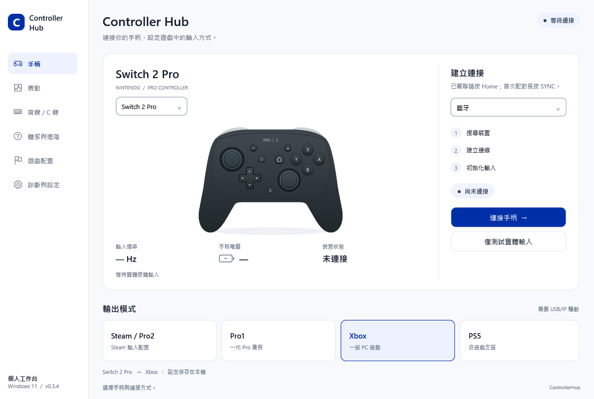
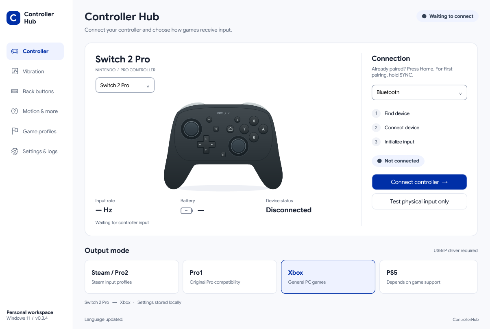
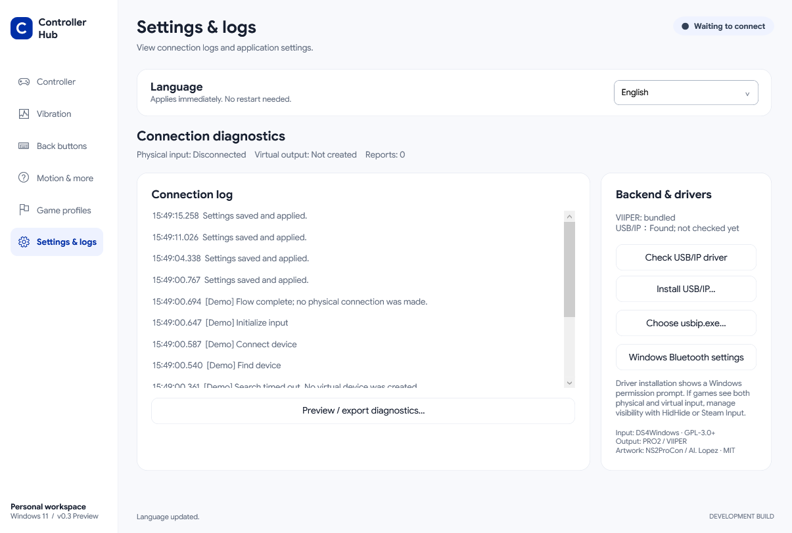
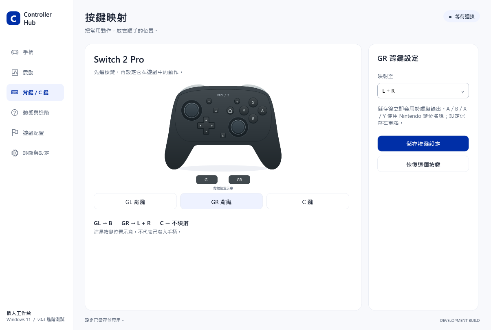
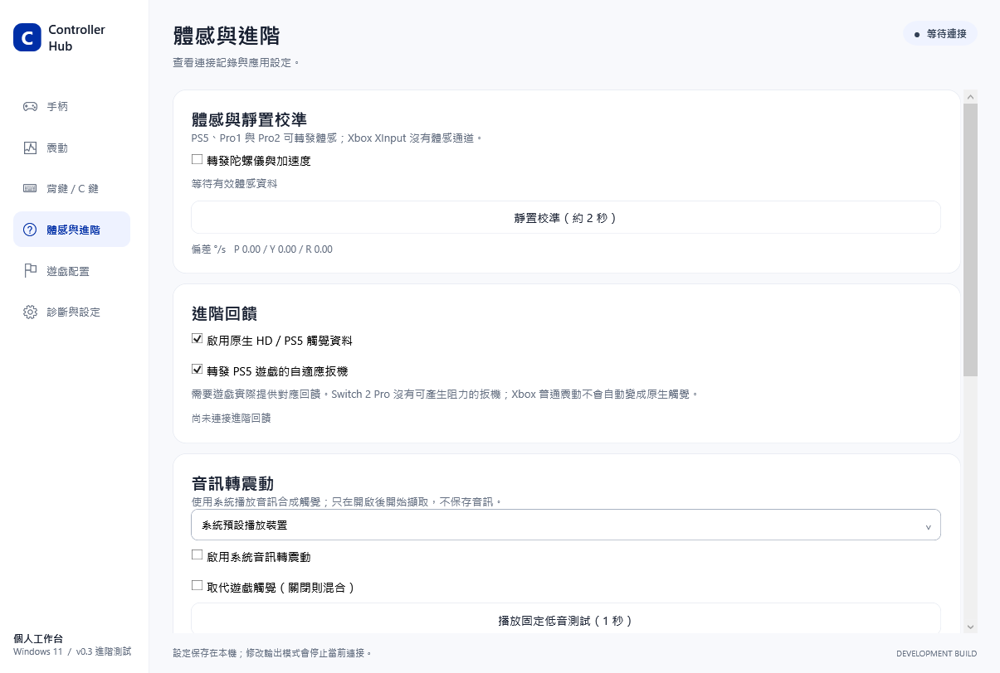
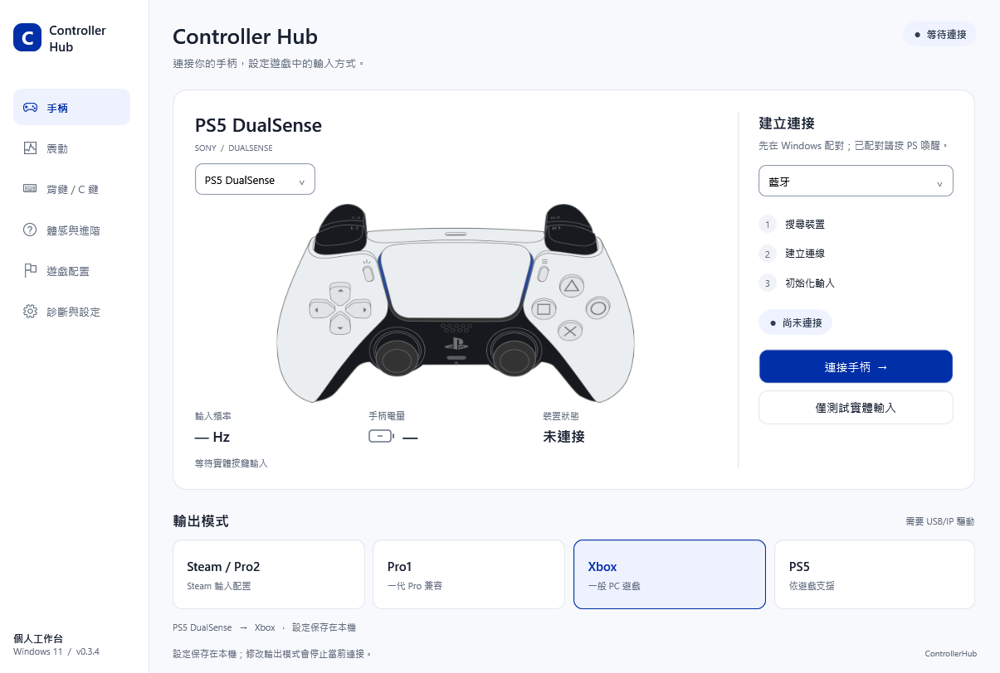

# ControllerHub

**讓 Switch 2 Pro 與 PS5 DualSense 在 Windows 上連得清楚、玩得順手。**

A Windows controller workspace for Switch 2 Pro and DualSense — USB / Bluetooth, virtual gamepads, motion and haptics.

`Windows 11 x64` · `C# / WPF / .NET 8` · `GPL-3.0-or-later` · **v0.3.0 Preview**

> 本專案目前為預覽版。主要輸入與回饋鏈路已有實機驗證，但尚未完成所有遊戲、藍牙與長時間穩定性驗收。請先閱讀[功能與相容性](docs/features.md)及[已知問題](docs/known-issues.md)。



*最新程式的離線介面預覽，尚未連接實體手柄。先前硬體實測另見[驗收狀態](docs/development/validation.md)；接收頻率不是端到端延遲。*

## 你可以用它做什麼

- **連接手柄**：支援 Switch 2 Pro、DualSense 的 USB／藍牙輸入路徑；DualSense 藍牙尚待實機驗收。
- **切換遊戲輸出**：Xbox、PS5、Pro1、Steam / Pro2 四種虛擬模式，依遊戲選擇。
- **調整 GL／GR／C**：為 Switch 2 Pro 背鍵和 C 鍵設定映射，儲存到電腦上的配置。
- **震動與觸覺**：普通震動、Switch 2 HD 震動，以及 PS5 USB 原生觸覺、自適應扳機的回饋轉發。
- **體感與校準**：讀取六軸資料、儲存靜置校準，轉發至支援體感的虛擬模式。
- **三語介面**：繁體中文、简体中文、English，即時切換並保存；英文使用隨附的 Google Sans。
- **看懂目前狀態**：祖母綠連接膠囊、電量／充電狀態、輸入率、分階段連接提示和可預覽的診斷報告。

Xbox 是一般 Windows 遊戲的建議起點。程式不要求遊戲從 Steam 啟動；PS5／Pro 模式能否使用進階功能，仍取決於遊戲或輸入中介軟體支援。

## 快速開始

1. 下載單 EXE 便攜版直接執行；或解壓完整 ZIP，保留 EXE、DLL、`Backend` 等資料夾。
2. **單 EXE 已包含 .NET 8**；ZIP 版需安裝 **.NET 8 Desktop Runtime x64**。需要虛擬輸出時，兩種版本都需要 **usbip-win2 Client** 驅動。
3. 執行 `ControllerHub.exe`，選擇手柄型號、USB／藍牙，以及輸出模式；初次使用建議選 **Xbox**。
4. 按「連接手柄」，確認顯示 **已連接・遊戲輸出就緒**，再啟動遊戲。

從 [GitHub Releases 下載 Windows 預覽包](https://github.com/MostimaJK/ControllerHub/releases/tag/v0.3.0-preview)。可選擇 **`ControllerHub-v0.3.0-preview-portable-win-x64.exe`**（單檔、包含 .NET）或 `ControllerHub-v0.3.0-preview-win-x64.zip`（完整解壓、另裝 .NET）。原始碼倉庫及 GitHub 的 Source code ZIP 不包含可直接執行的成品。

單 EXE 首次啟動會自動準備本機快取，之後重用已校驗的檔案。它不會自動安裝驅動。詳見[便攜版說明](docs/portable.md)。

[安裝指南](docs/install.md) · [使用指南](docs/usage.md) · [功能與相容性](docs/features.md) · [故障排查](docs/troubleshooting.md)

## 介面語言

到「診斷與設定 → Language / 語言」選擇繁體中文、简体中文或 English，立即生效並保存在本機。切換語言不改動按鍵映射、連接方式或虛擬輸出模式。英文使用隨程式附帶的 Google Sans，不需另外安裝字體。





*以上為最新程式的離線介面示範，未連接實體手柄。*

## 介面預覽

### 背鍵與 C 鍵



### 體感與進階回饋



### DualSense



*以上三張是由最新程式離線渲染的介面示範，展示版面與控制項，不代表圖中功能已完成實機連接。實測範圍請以功能表為準。*

## 開發與重建

需要 Windows、Git 及 **.NET 8 SDK**。從專案根目錄執行：

```powershell
./scripts/bootstrap.ps1
./build.ps1 -Check -Package
```

`bootstrap.ps1` 依照 `DEPENDENCIES.lock.json` 還原固定版本上游原始碼、套用整合補丁並校驗後端雜湊。`build.ps1` 產生 `dist/`，執行離線檢查，並將 ZIP 與 SHA-256 放到 `releases/latest/`。此流程不會安裝驅動或操作實體手柄。

詳見[開發指南](docs/development/build.md)、[架構](docs/development/architecture.md)與[驗收狀態](docs/development/validation.md)。

## 授權與致謝

ControllerHub 整合原始碼使用 **GPL-3.0-or-later**，完整授權見 [COPYING](COPYING)。本專案建立在以下開源工作之上：

- [DS4Windows](https://github.com/hbashton/DS4Windows)：手柄輸入、裝置生命週期與回饋基礎。
- [PRO2 Bridge](https://github.com/LeonChrome/XinHeLianSheng-Pro2-Bridge)：PRO2／VIIPER 整合與協定參考。
- [usbip-win2](https://github.com/vadimgrn/usbip-win2)：虛擬 USB 裝置輸出所需的 Windows 驅動。
- [NS2ProCon](https://github.com/ErenYaeger999/NS2ProCon)：Switch 2 Pro 手柄圖例的來源。
- [Gamepad Asset Pack](https://github.com/AL2009man/Gamepad-Asset-Pack)：DualSense 圖片，Al. Lopez。
- [HidHide](https://github.com/nefarius/HidHide)：可選的實體 HID 隱藏功能。

各元件保留自己的授權；版本、雜湊、對應原始碼與圖片聲明見 [THIRD_PARTY_NOTICES.md](THIRD_PARTY_NOTICES.md)、[DEPENDENCIES.lock.json](DEPENDENCIES.lock.json) 與 [圖片授權](docs/artwork.md)。這是獨立社群專案，並非 Nintendo、Sony 或 Microsoft 的官方軟體。
