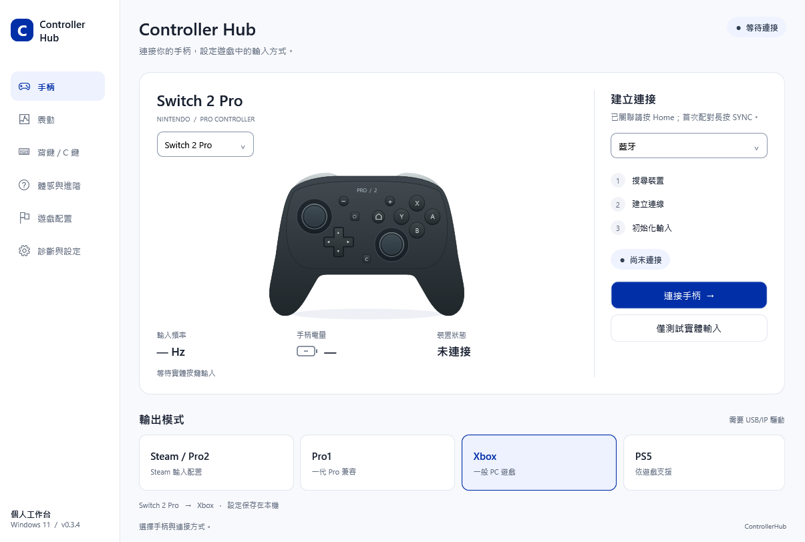
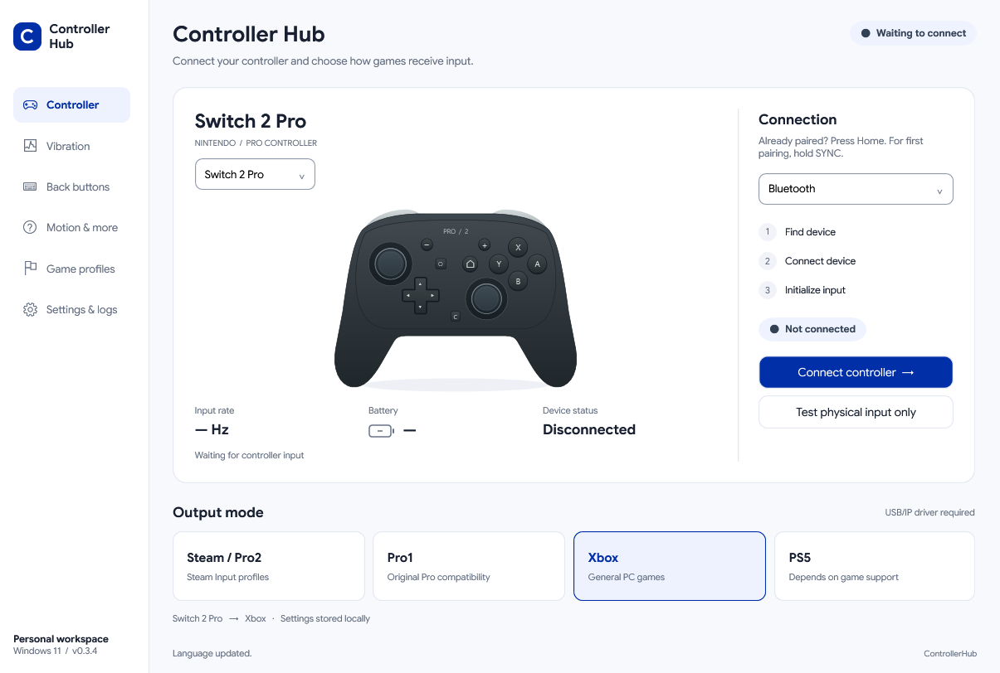
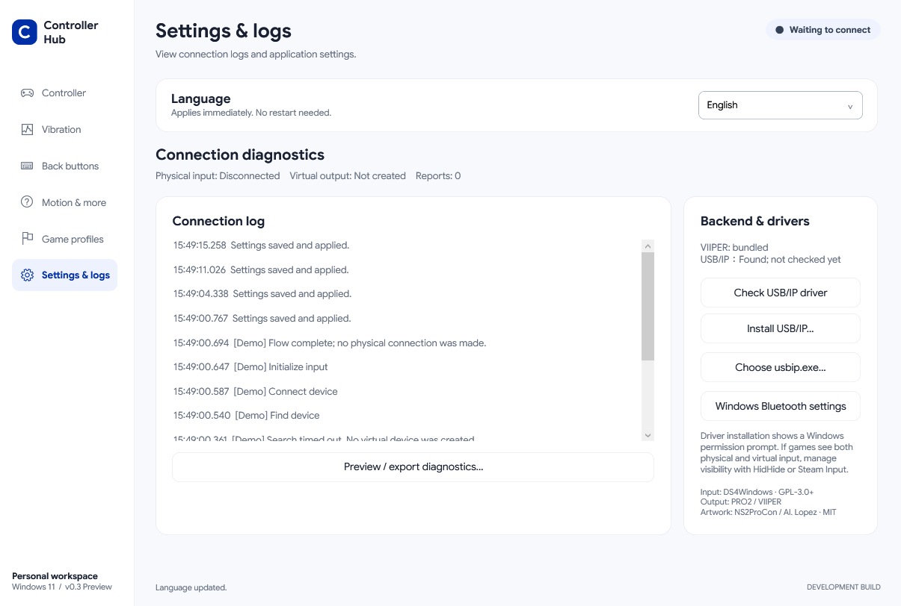
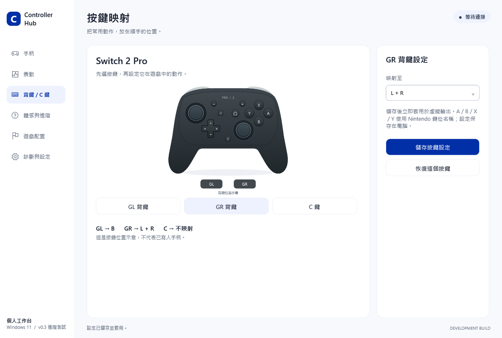
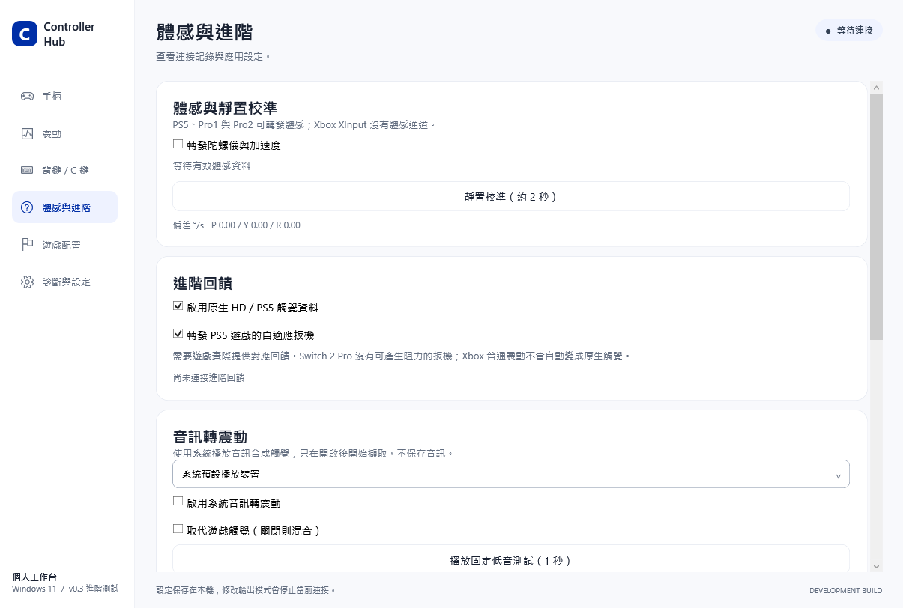
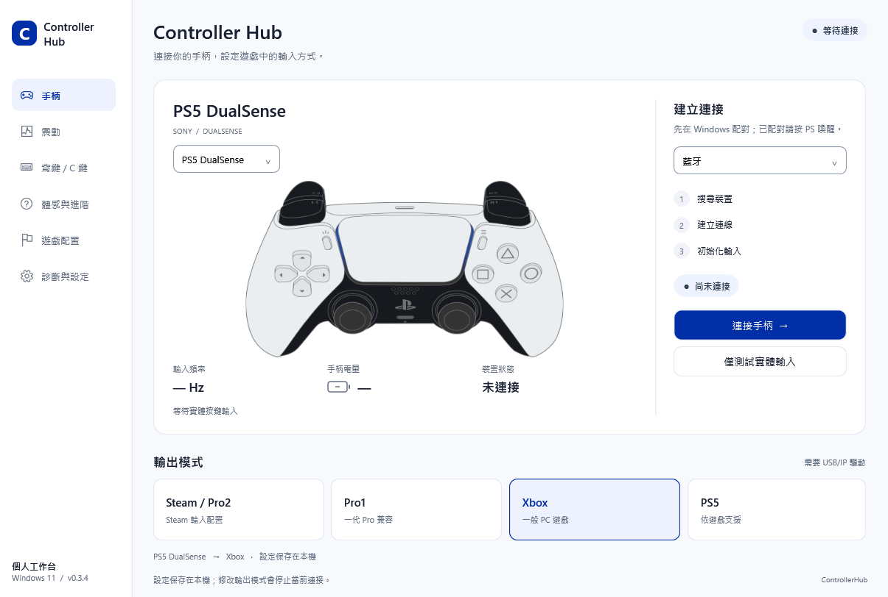

# ControllerHub

[English](README.md) · [简体中文](README.zh-Hans.md) · [繁體中文](README.zh-Hant.md)

**让 Switch 2 Pro 与 PS5 DualSense 在 Windows 上连得清楚、玩得顺手。**

A Windows controller workspace for Switch 2 Pro and DualSense — USB / Bluetooth, virtual gamepads, motion and haptics.

`Windows 11 x64` · `C# / WPF / .NET 10` · `GPL-3.0-or-later` · **v1.0.0**

> 主要输入与回馈链路已有实机验证，但尚未完成所有游戏、蓝牙与长时间稳定性验收。请先阅读[功能与相容性](docs/features.md)及[已知问题](docs/known-issues.md)。

### 从原始码比较桌面界面

双击 `Start-ControllerHub-WebView2.bat` 启动主要 WebView2 界面，`Start-ControllerHub.bat` 启动原生 WPF 版，双击 `Start-ControllerHub-Electron.bat` 启动 Electron 版。两者共用本机设置与手柄引擎，请先退出目前版本再切换。以上入口均会先用 .NET 10 SDK 编译；Electron 入口还会寻找本机 Electron，首次缺少时透过 npm 安装。



*最新程序的离线界面预览，尚未连接实体手柄。先前硬体实测另见[验收状态](docs/development/validation.md)；接收频率不是端到端延迟。*

## 你可以用它做什麽

- **连接手柄**：支援 Switch 2 Pro、DualSense 的 USB／蓝牙输入路径；DualSense 蓝牙尚待实机验收。
- **切换游戏输出**：Xbox、PS5、Pro1、Steam / Pro2 四种虚拟模式，依游戏选择。
- **调整 GL／GR／C**：为 Switch 2 Pro 背键和 C 键设置映射，储存到电脑上的配置。
- **震动与触觉**：普通震动、Switch 2 HD 震动，以及 PS5 USB 原生触觉、自适应扳机的回馈转发。
- **体感与校准**：读取六轴资料、储存静置校准，转发至支援体感的虚拟模式。
- **三语界面**：繁体中文、简体中文、English，即时切换并保存；英文使用随附的 Google Sans。
- **看懂目前状态**：祖母绿连接胶囊、电量／充电状态、输入率、分阶段连接提示和可预览的诊断报告。

Xbox 是一般 Windows 游戏的建议起点。程序不要求游戏从 Steam 启动；PS5／Pro 模式能否使用进阶功能，仍取决於游戏或输入中介软件支援。

## v1.0.0 更新

- 新增 WebView2 主界面、Lucide 图示、三阶段连接状态与独立 WPF／Electron 启动入口。WebView2 Runtime 无法启动时会回到 WPF。

- **连接与退出更可靠**：修正停止写入的重试、精确查核本次虚拟连接埠；清理失败保留复原记录，避免叠加连接。
- **松键即时性**：合并重复状态，避免旧输入堆积；加入过期输入及断流中立保护。
- **.NET 10 与资源使用**：重用映射与编码缓冲，无输入时采事件等待，最小化暂停界面指标刷新。
- **日常使用界面**：移除开发版浮水印及测试版侧栏标示，保留必要的诊断与回馈检查。

先前 v0.3.4 的验收记录：109 项离线检查、2,430 项相关上游回归测试、18 项 Windows 消费端检查通过；Switch USB 同一引擎八轮连接／模式切换／断开通过。使用者已回报一段时间使用暂未再出现问题；这不等於所有游戏、手柄或长期负载皆已通过。详见[集中验收](docs/development/completion.md)与[性能测量](docs/development/performance.md)。

## 快速开始

1. 下载单 EXE 便携版直接执行；或解压完整 ZIP，保留 EXE、DLL、`Backend` 等资料夹。
2. **单 EXE 已包含 .NET 10**；ZIP 版需安装 **.NET 10 Desktop Runtime x64**。需要虚拟输出时，两种版本都需要 **usbip-win2 Client** 驱动。
3. 执行 `ControllerHub.exe`，选择手柄型号、USB／蓝牙，以及输出模式；初次使用建议选 **Xbox**。
4. 按「连接手柄」，确认显示 **已连接?游戏输出就绪**，再启动游戏。

发布附件请见 [GitHub Releases](https://github.com/MostimaJK/ControllerHub/releases)。1.0.0 的便携包名为 `ControllerHub-v1.0.0-portable-win-x64.exe`，框架相依包为 `ControllerHub-v1.0.0-win-x64.zip`，各附 SHA-256。

单 EXE 首次启动会自动准备本机快取，之後重用已校验的文件。它不会自动安装驱动。详见[便携版说明](docs/portable.md)。

[安装指南](docs/install.md) · [使用指南](docs/usage.md) · [功能与相容性](docs/features.md) · [故障排查](docs/troubleshooting.md)

## 界面语言

首次启动预设使用英文。到「诊断与设置 → Language / 语言」选择繁体中文、简体中文或 English，立即生效并保存在本机。切换语言不改动按键映射、连接方式或虚拟输出模式。英文使用随程序附带的 Google Sans，不需另外安装字体。





*以上为最新程序的离线界面示范，未连接实体手柄。*

## 界面预览

### 背键与 C 键



### 体感与进阶回馈



### DualSense



*以上三张是由最新程序离线渲染的界面示范，展示版面与控制项，不代表图中功能已完成实机连接。实测范围请以功能表为准。*

## 开发与重建

需要 Windows、Git 及 **.NET 10 SDK**。从专案根目录执行：

```powershell
./scripts/bootstrap.ps1
./build.ps1 -Check -Package
```

`bootstrap.ps1` 依照 `DEPENDENCIES.lock.json` 还原固定版本上游原始码、套用整合补丁并校验後端杂凑。`build.ps1` 产生 `dist/`，执行离线检查，并将 ZIP 与 SHA-256 放到 `releases/latest/`。此流程不会安装驱动或操作实体手柄。

详见[开发指南](docs/development/build.md)、[架构](docs/development/architecture.md)与[验收状态](docs/development/validation.md)。

## 授权与致谢

ControllerHub 整合原始码使用 **GPL-3.0-or-later**，完整授权见 [COPYING](COPYING)。本专案建立在以下开源工作之上：

- [DS4Windows](https://github.com/hbashton/DS4Windows)：手柄输入、装置生命周期与回馈基础。
- [PRO2 Bridge](https://github.com/LeonChrome/XinHeLianSheng-Pro2-Bridge)：PRO2／VIIPER 整合与协定参考。
- [usbip-win2](https://github.com/vadimgrn/usbip-win2)：虚拟 USB 装置输出所需的 Windows 驱动。
- [NS2ProCon](https://github.com/ErenYaeger999/NS2ProCon)：Switch 2 Pro 手柄图例的来源。
- [Gamepad Asset Pack](https://github.com/AL2009man/Gamepad-Asset-Pack)：DualSense 图片，Al. Lopez。
- [HidHide](https://github.com/nefarius/HidHide)：可选的实体 HID 隐藏功能。

各元件保留自己的授权；版本、杂凑、对应原始码与图片声明见 [THIRD_PARTY_NOTICES.md](THIRD_PARTY_NOTICES.md)、[DEPENDENCIES.lock.json](DEPENDENCIES.lock.json) 与 [图片授权](docs/artwork.md)。这是独立社群专案，并非 Nintendo、Sony 或 Microsoft 的官方软件。
