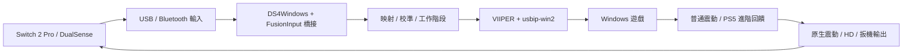

# 架構與設計邊界

ControllerHub 採 C#／.NET 8 WPF。介面以白底、克萊因藍操作色與祖母綠成功狀態呈現，實體手柄輸入與虛擬輸出分開建立就緒證據。

- WPF 介面：手柄選擇、連接、背鍵、震動、體感、配置與診斷。
- `ControllerEngine`：管理單手柄工作階段；傳輸與音訊操作在背景執行。
- `FusionInput`／`FusionAdvanced`：編譯進固定版本的 DS4Windows 組件，以存取內部裝置 API。改動記在 integration patch，不依賴使用者另外安裝 DS4Windows。
- `VirtualOutput`：管理僅本工作階段擁有的 VIIPER 程序、資料流與 USB/IP 匯入埠，輸出 Xbox／PS5／Pro1／Pro2 報告。
- 回饋：普通震動與原生觸覺分層處理；PS5 觸覺資料可轉為 Switch 2 HD，扳機阻力只對有硬體支援的 DualSense 有效。

連接成功至少需要連續有效實體輸入，虛擬輸出也需對應 Windows 端點就緒。退出需要停止回饋、送出中立狀態、等待原生操作完成，再退役輸入及清理自己的虛擬裝置。不得用強制釋放仍在操作中的 handle 來掩蓋清理失敗。

目前保留內部 ControllerFusion 識別與使用者資料目錄。多手柄並行與全面重寫輸入後端不屬於本版已完成範圍。
