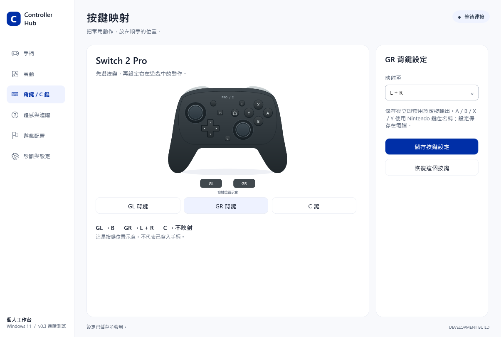

# 使用指南

## 選擇介面語言

在「診斷與設定」最上方的 Language / 語言選單，選擇 **繁體中文**、**简体中文**或 **English**。設定即時生效，重新開啟仍會保留。介面語言獨立於遊戲配置，切換配置不會意外更改語言。

English 使用程式內嵌的 Google Sans Regular／Bold；不用安裝系統字體，程式離線也能顯示。繁體中文使用 Microsoft JhengHei UI，簡體中文使用 Microsoft YaHei UI 等系統字體回退。

首頁標題固定顯示 **Controller Hub**。

## 第一次連接

先退出其他正在操作同一支手柄的映射程式，例如 PRO2 助手、DS4Windows。排查問題時也可先退出 Steam，確認單一輸入路徑正常後再依遊戲設定 Steam Input。

### Switch 2 Pro：USB

用資料線接上，選「Switch 2 Pro」和「USB 有線」，輸出先選「Xbox」，再按「連接手柄」。目前已驗證未按 Home 也能連接；若手柄未喚醒，可短按 Home，不必反覆按 SYNC。

目前首次讀取可能報錯，程式會自動重試，約增加一秒等待。請以綠色「已連接・遊戲輸出就緒」為成功依據，而不是只看 Windows 裝置名稱。

### Switch 2 Pro：藍牙

首次配對長按頂部 SYNC，讓指示燈持續閃爍，再由程式開始搜尋與建立連接。已成功關聯的手柄，通常短按 Home 喚醒後連接即可；不要在每次重連時重新長按 SYNC。主板使用外接 Wi-Fi／藍牙天線時，請確認天線已裝妥。

### DualSense：USB／藍牙

USB：使用資料線接上，選「PS5 DualSense」與「USB 有線」，再連接。

藍牙：先在 Windows「設定 → 藍牙與裝置」配對。手柄關機且 USB 拔除時，按住 Create＋PS，直到燈閃爍，再選 Wireless Controller。已配對則按 PS 喚醒。**本專案 DualSense 藍牙路徑尚未實測驗收**；若手柄離開 USB 完全無法喚醒，不能只憑此現象判定是程式或藍牙硬體故障。

## 選擇輸出模式

| 模式 | 適用情境 | 限制 |
|---|---|---|
| Xbox | 一般 Windows／XInput 遊戲，建議先從此模式開始 | XInput 沒有六軸體感或 PS5 原生觸覺通道 |
| PS5 | 遊戲支援 DualSense 輸入、觸覺或扳機時 | 虛擬 PS5 不保證與實體 DualSense 在每款遊戲中有相同識別結果 |
| Pro1 | 支援一代 Pro 協定的遊戲或輸入中介軟體 | 需遊戲／中介軟體支援 |
| Steam / Pro2 | 使用 Pro2 輸入的相容情境，包含 Steam Input 配置 | 此標籤不是「只能從 Steam 啟動」；個別遊戲相容性尚待驗證 |

更改來源、傳輸方式或輸出模式後，重新建立連接。只看到虛擬裝置已列舉，不代表遊戲已支援其全部進階回饋。

## 背鍵／C 鍵

在「背鍵 / C 鍵」選擇 GL、GR 或 C，設定單鍵／組合鍵後儲存。這是本機的輸入映射，不會改寫手柄韌體或永久燒錄背鍵設定。按鍵採 Nintendo 名稱，與 Xbox A／B／X／Y 的位置命名不同。

## 震動與回饋

- 「測試普通震動」：直接驗證實體手柄能否接收震動。
- 「測試 Xbox 回饋鏈路」：驗證 Windows 遊戲 API → 虛擬 Xbox → 實體手柄。
- 「測試原生 HD 震動」：測試支援的 Switch 2 原生 HD 路徑。

三者驗證不同層次。遊戲的雙馬達普通震動不會憑空產生原本不存在的高解析觸覺資料。

## 體感、觸覺與扳機

到「體感與進階」開啟體感轉發；將手柄平放靜止，按「靜置校準（約 2 秒）」，確認校準已儲存。虛擬 PS5／Pro1／Pro2 可承載相應資料，但遊戲仍需使用它們；Xbox 模式不提供六軸。

PS5 原生觸覺與自適應扳機須由遊戲提供相應回饋。DualSense USB 的觸覺與扳機鏈路已有實測；Switch 2 Pro 可以接收轉換後的 HD 震動，但沒有可產生扳機阻力的硬體。

## 系統音訊轉震動（實驗功能）

選擇目前真正播放聲音的輸出裝置，開啟系統音訊轉震動，再以較低增益播放短段音訊。「取代遊戲觸覺」關閉時混合，開啟時以音訊觸覺取代。測試後可直接關閉。

目前短時間 USB 測試已感到震動，尚未完成長時間驗收；歷史測試曾影響輸入回應，詳見[已知問題](known-issues.md)。發布包預設關閉；使用者自行開啟後應留意設定保存狀態。這是系統音訊的效果轉換，不等同遊戲原生提供的材質、碰撞等觸覺訊號。

## 電量、配置與診斷

電量依手柄回報顯示，可能有離散級距，不保證精確到每 1%。沒有有效電量時應以未知狀態處理。

遊戲配置、重連、USB 優先與托盤選項已接入，但切換／睡眠喚醒仍需更多實機回歸。需要回報問題時，到「診斷與設定」預覽診斷報告再儲存；雖會遮蔽常見識別資訊，上傳前仍請檢查內容。
